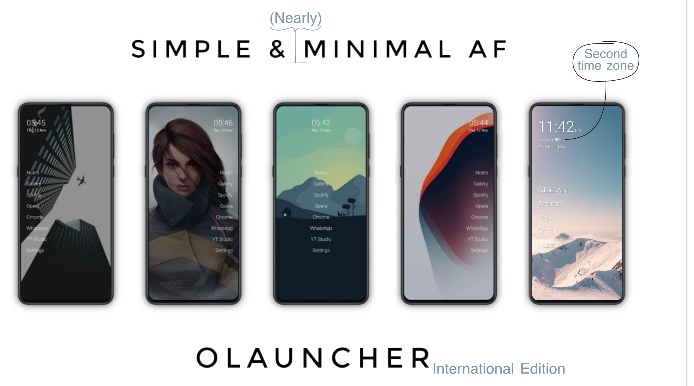

# Olauncher | Minimal AF Launcher — International Edition
AF stands for Ad-Free

A fork of [Olauncher](https://github.com/tanujnotes/Olauncher) for people who
live in one time zone and care about another one: the home screen shows a
**second clock** with a small flag next to it, right below the main time. Plus a
custom wallpaper and a set of personal defaults. Everything else is upstream
Olauncher.

Both the time zone and the flag are meant to be changed — see the two how-tos
below.

## Second clock (Australia by default)
The home screen shows a second, smaller clock below the main one, pinned to
`Australia/Brisbane` (AEST, UTC+10, no daylight saving) and marked with a small
Australian flag icon (`res/drawable/ic_flag_aus.xml`, tinted to match the text
color). Both clocks show a small AM/PM marker in 12-hour mode. Defined in
`res/layout/fragment_home.xml` (+ `layout-land`), wired up in `HomeFragment`.
Tapping it opens the clock app, same as the main clock, and it follows the
same *date & time* visibility setting.

### Use your own time zone
The second clock is a plain `TextClock` with `android:id="@+id/clock2"`, so a
single attribute controls which zone it shows. Change `android:timeZone` in
**both** layouts (portrait and landscape), otherwise the clock jumps back to
Brisbane when the phone is rotated:

- `app/src/main/res/layout/fragment_home.xml`
- `app/src/main/res/layout-land/fragment_home.xml`

```xml
<TextClock
    android:id="@+id/clock2"
    ...
    android:timeZone="Europe/Berlin"
    android:format12Hour="h:mm a"
    android:format24Hour="HH:mm" />
```

Any [IANA time zone ID](https://en.wikipedia.org/wiki/List_of_tz_database_time_zones)
works (`Europe/Berlin`, `America/New_York`, `Asia/Tokyo`, …). Use the region ID
rather than a fixed offset, so daylight saving is handled for you.

### Use your own flag
The flag is just a vector drawable pulled in via `android:drawableEnd`, tinted
to the text color with `android:drawableTint="?attr/primaryColor"` so it works
in both light and dark mode.

1. Get an SVG of the flag (`icons/flag_aus_transparent.svg` is the one used
   here — outline only, since the drawable gets tinted to a single color).
2. In Android Studio: right-click `res/drawable` → *New* → *Vector Asset* →
   *Local file*, pick the SVG, name it `ic_flag_xyz`. This writes
   `res/drawable/ic_flag_xyz.xml`.
3. Point both `fragment_home.xml` layouts at it:
   `android:drawableEnd="@drawable/ic_flag_xyz"`.

Keep the aspect ratio roughly 2:1 (`android:width="26dp"`,
`android:height="13dp"` here) so the icon sits nicely next to the time. Drop
the `drawableEnd`/`drawablePadding`/`drawableTint` lines if you want no flag at
all — the time then stands on its own.

## Custom wallpaper
- Settings → *Choose wallpaper from gallery*: tap to pick any image; it is
  center-cropped and set as home + lock screen wallpaper.
- Long-press the same entry to restore the default photo (diamond beach,
  bundled as `res/drawable-nodpi/wallpaper_default.jpg`), which is also set
  automatically on first open.
- Picking a custom or default wallpaper disables the daily-wallpaper worker.

## Personal defaults (`data/PersonalDefaults.kt`)
Applied once on first open (fresh install / after clearing app data):

- **Home screen apps (5):** WhatsApp, Calendar, Maps, Mail (Gmail), Fitbit.
- **App renames:** `0 Chrome`, `0 Clock`, `0 Phone`, `1 Messages`,
  `1 Outlook (TUM)`, `2 Camera`, `2 Photos`.
  The number prefixes group the apps at the top of the alphabetically sorted
  app drawer, so typing a single digit in the search overview directly brings
  up the wanted group of apps (0 = daily tools, 1 = communication, 2 = camera
  and photos).

Edit `PersonalDefaults.kt` to change these; renames can still be adjusted at
runtime via long-press in the app drawer as usual.

## Building
```bash
JAVA_HOME="/Applications/Android Studio.app/Contents/jbr/Contents/Home" \
ANDROID_HOME="$HOME/Library/Android/sdk" ./gradlew assembleDebug
adb install -r app/build/outputs/apk/debug/app-debug.apk
```

There is no release build of this fork — build it yourself, or use upstream
Olauncher below if you don't need the second clock.

##

# Upstream Olauncher

Everything from here on is the original project by
[tanujnotes](https://github.com/tanujnotes/Olauncher) — the store links install
the plain launcher, without the second clock.

[](https://f-droid.org/packages/app.olauncher)
[](https://play.google.com/store/apps/details?id=app.olauncher)

### Install using [F-Droid](https://f-droid.org/packages/app.olauncher), [Play Store](https://play.google.com/store/apps/details?id=app.olauncher) or the [latest APK](https://github.com/tanujnotes/Olauncher/releases/).

- To maintain the simplicity of the launcher, a few niche features are available but hidden.

- Please check out the **[About](https://tanujnotes.substack.com/p/olauncher-minimal-af-launcher?utm_source=github)** page in the Olauncher settings for a complete list of features and **FAQs**.

##

License: [GNU GPLv3](https://www.gnu.org/licenses/gpl-3.0.en.html)

Dev: [X/twitter](https://x.com/tanujnotes) • [Bluesky](https://bsky.app/profile/tanujnotes.bsky.social)

##

### My other apps:

- [Pro Launcher](https://play.google.com/store/apps/details?id=app.prolauncher) - Pro version of Olauncher with extra features like widgets, weather, folders, etc.

- [Note to Self](https://play.google.com/store/apps/details?id=com.makenotetoself) - Free and [open source](https://github.com/jeerovan/ntsapp) notes app with chat like interface and end-to-end encryption.

- [Pentastic](https://play.google.com/store/apps/details?id=app.pentastic) - Minimal todo lists. Free and [open source](https://github.com/tanujnotes/Pentastic).
